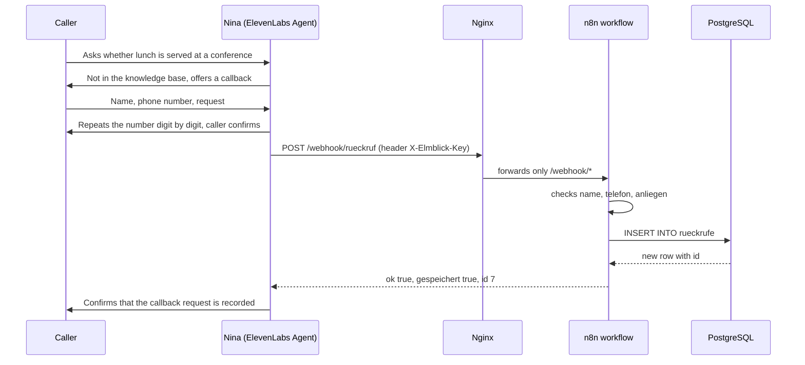

# Voice Agent Hotel

**Nina** is the AI receptionist of *Hotel Elmblick*, a fictional family-run
hotel in Schöningen, Lower Saxony. She picks up the phone in German, answers
questions about rooms, prices, breakfast, arrival and house rules, checks
which rooms are free for a stay and what it costs, records booking requests and
takes callback requests for the team when a question needs a human.

The conversation runs on **ElevenLabs Agents**, calls come in through a
**Telnyx** SIP trunk. When Nina needs data, she uses webhook tools that call my
own server, where **n8n** workflows validate the request and query or write to
**PostgreSQL**. Everything on the server runs in **Docker** behind **Nginx** on
a Hostinger VPS.

> **Status:** Nina is live under a German local number (05352, Schöningen). She
> checks free rooms, records booking requests and takes callback requests.

<picture>
  <source media="(prefers-color-scheme: dark)" srcset="docs/architecture-dark.svg">
  
</picture>

---

## Contents

- [How it works](#how-it-works)
- [Features](#features)
- [Tech stack](#tech-stack)
- [Project structure](#project-structure)
- [Security](#security)
- [Setup](#setup)
- [Testing the webhook](#testing-the-webhook)
- [Design decisions](#design-decisions)
- [Model choice](#model-choice)
- [Roadmap](#roadmap)

---

## How it works

The architecture above shows where each part runs. The sequence below follows
a single callback request from the first question to the stored row.



Every stored request carries the ElevenLabs conversation ID (`anruf_id`), so
each row in the database can be traced back to the call transcript.

Field and table names are German because the hotel team works with the data:
`rueckrufe` = callbacks, `telefon` = phone, `anliegen` = request,
`erreichbar` = when to reach the caller, `gespeichert` = saved, `fehlt` = missing,
`offen` / `erledigt` / `nicht_erreicht` = open / done / not reached.

---

## Features

- Natural phone conversation in German
- Answers based on a curated knowledge base of the hotel (`agent/knowledge_base.md`)
- **Tool calling:** Nina decides on her own when to use which tool:
  - `verfuegbarkeit_pruefen` checks free rooms and the total price for a stay,
    based on dates, adults, children, babies and needs like separate beds or an
    accessible room
  - `buchungsanfrage_aufnehmen` records a booking request for a free room
    category, including wishes like a forest view, for the team to confirm
  - `rueckruf_aufnehmen` sends a callback request with name, phone number,
    request, availability and conversation ID
- Dates like "next Friday" are turned into exact dates and read back for
  confirmation; prices are taken exactly from the database
- Phone numbers are always repeated digit by digit and confirmed before saving
- Every booking request and callback request is emailed to the team right away
- Server-side validation: incomplete or impossible requests are answered with
  `ok: false` and the reason, so Nina can ask for exactly what is missing
- Callback requests stored in PostgreSQL with status `offen`, `erledigt` or
  `nicht_erreicht`
- Honest by design: Nina introduces herself as an AI assistant, never confirms a booking, never
  promises a callback time and never claims to have saved something when the
  tool failed
- Ends the call politely after the caller says goodbye, or after 30 seconds of
  silence
- Cost limits: maximum call duration of eight minutes and a monthly spending cap

---

## Tech stack

| Component        | Used for                                                  |
| ---------------- | --------------------------------------------------------- |
| ElevenLabs Agents| Speech recognition, LLM, voice, webhook tools             |
| n8n 2.43         | Webhooks, validation, database queries                    |
| PostgreSQL 16    | Rooms, occupancy, requests (separate database `hotel`)    |
| Docker Compose   | Runs n8n and PostgreSQL on the server                     |
| Nginx            | Reverse proxy, exposes only the webhook path              |
| Let's Encrypt    | TLS certificate via certbot                               |
| Ubuntu 24.04 VPS | Hostinger, shared with other projects                     |
| Telnyx           | German local phone number via SIP trunk                   |
| Gmail (SMTP)     | Notification emails to the team                           |

---

## Project structure

```
Voice-Agent-Hotel/
├── agent/
│   ├── system_prompt.md            # Nina's instructions (German)
│   ├── knowledge_base.md           # What Nina knows about the hotel (German)
│   ├── tool_buchungsanfrage_aufnehmen.json # Webhook tool: booking request
│   ├── tool_rueckruf_aufnehmen.json  # Webhook tool: callback request
│   └── tool_verfuegbarkeit_pruefen.json # Webhook tool: free rooms and prices
├── docs/
│   ├── architecture-light.svg      # Architecture diagram (light and dark)
│   ├── architecture-dark.svg
│   └── architecture.archify.json   # Diagram source, built with archify
├── n8n/
│   ├── elmblick_buchungsanfrage.json # Workflow export: Webhook → Code check → If → Insert → Respond → Email
│   ├── elmblick_rueckrufbitte.json # Workflow export: Webhook → If → Postgres → Respond → Email
│   └── elmblick_verfuegbarkeit.json # Workflow export: Webhook → Code check → If → verfuegbarkeit() → Respond
├── server/
│   ├── compose.yaml                # n8n + PostgreSQL
│   ├── nginx-n8n.conf              # Only /webhook/ is public
│   └── .env.example                # Required secrets, without values
└── sql/
    ├── 001_hotel_database.sql      # Database, role and table for callback requests
    ├── 002_least_privilege.sql     # Separate owner, hotel_app may only INSERT and SELECT
    ├── 003_rooms_and_requests.sql  # Stage 2: room categories, rooms, occupancy, booking requests
    ├── 004_demo_data.sql           # Invented occupancy for testing availability
    ├── 005_babies.sql              # Babies take no bed, at most one cot per room
    └── 006_availability_function.sql # verfuegbarkeit(): free rooms and price for a stay
```

---

## Security

- **Only the webhook is public.** Nginx forwards `/webhook/` to n8n and answers
  every other path with `404`, including the editor, the login page and
  `/healthz`. The editor is opened through an SSH tunnel only.
- **Shared secret.** The webhooks use n8n Header Auth (`X-Elmblick-Key`).
  In ElevenLabs the key is stored as a secret, so the language model never
  sees it. Requests without the key get `403`.
- **Ports bound to localhost.** Docker publishes n8n only on
  `127.0.0.1:5678`. This matters because Docker writes its own firewall rules
  in front of `ufw`; a plain `5678:5678` would be reachable from the internet
  even though `ufw` claims otherwise. PostgreSQL has no published port at all.
- **Least privilege.** The workflows use their own role `hotel_app`,
  not the superuser that n8n uses internally. Database and tables belong
  to `hotel_owner`, a role without login. `hotel_app` may only read rooms and
  occupancy, add and read callback and booking requests and run
  `verfuegbarkeit()`, so even with a stolen webhook key nothing can be
  changed or deleted. `CONNECT` on n8n's internal database and on `postgres`
  is revoked from `PUBLIC`.
- **Guardrails in ElevenLabs.** On top of the rules in the prompt, the
  manipulation guardrail ends a call on prompt injection attempts, and content
  guardrails block sexual, harassing, obscene or violent answers. They run in
  streaming mode, so they add no delay. Categories that would hit normal hotel
  questions stay off: medical and legal (allergies, cancellation terms),
  politics and religion (the cathedral nearby) and self-harm, because a caller
  in crisis should be referred to 112, not cut off.
- **Secrets stay on the server.** `.env` with the database password and the
  n8n encryption key is never committed; see `server/.env.example`.
- **Memory limits.** n8n may use at most 1 GB of RAM and PostgreSQL 512 MB,
  so the agent cannot take memory away from the other services on the same
  VPS.

---

## Setup

### 1. Server

Requires Docker with the Compose plugin, Nginx and certbot with its Nginx
plugin (`python3-certbot-nginx`). The files use my domain
`n8n.benjaminblarr.de`; replace it with yours in `server/compose.yaml`,
`server/nginx-n8n.conf` and the three `agent/tool_*.json` files first.

```bash
sudo mkdir -p /opt/voice-agent && sudo chown $USER:$USER /opt/voice-agent
# copy server/compose.yaml and server/nginx-n8n.conf to /opt/voice-agent/
cd /opt/voice-agent
( umask 077; { echo "POSTGRES_PASSWORD=$(openssl rand -hex 24)"; \
  echo "N8N_ENCRYPTION_KEY=$(openssl rand -hex 32)"; } > .env )
sudo docker compose up -d
curl -s http://127.0.0.1:5678/healthz   # {"status":"ok"}
```

Then publish the webhook path through Nginx and get a certificate:

```bash
sudo install -m 644 -o root -g root nginx-n8n.conf /etc/nginx/sites-available/n8n
sudo ln -s /etc/nginx/sites-available/n8n /etc/nginx/sites-enabled/
sudo nginx -t && sudo systemctl reload nginx
sudo certbot --nginx -d n8n.example.com
```

### 2. Database

```bash
sudo docker compose exec postgres psql -U n8n -d n8n
```

Then run the statements from `sql/001_hotel_database.sql` and after that
`sql/002_least_privilege.sql` step by step. `sql/003_rooms_and_requests.sql`
to `sql/006_availability_function.sql` add rooms, occupancy, booking requests
and the availability function for stage 2. The password for `hotel_app` is
set interactively with `\password`.

### 3. n8n

Open the editor through the tunnel
(`ssh -N -L 15678:127.0.0.1:5678 <server>`, then `http://localhost:15678`),
create the owner account and three credentials:

- **Postgres:** host `postgres`, database `hotel`, user `hotel_app`, SSL disabled
- **Header Auth:** name `X-Elmblick-Key`, value from `openssl rand -hex 32`
- **SMTP:** for Gmail host `smtp.gmail.com`, port `465`, SSL on, and an app
  password instead of the account password

Import the three workflows from `n8n/`, assign the credentials, set the
sender and the team address in the two Send Email nodes (`nina@example.com`,
`team@example.com` in the exports) and publish them.

### 4. ElevenLabs

Create an agent, paste `agent/system_prompt.md` as the system prompt and add
`agent/knowledge_base.md` to the knowledge base. Set the timezone to
`Europe/Berlin`, otherwise the agent does not know today's date. Create the
webhook tools from the three `agent/tool_*.json` files and store the key as a
secret header.
Enable the system tool `end_call`. Changes reach the phone only after
**Publish**; the browser preview uses the draft.

All three tools use forced pre-tool speech, so Nina says a short sentence such
as "one moment, I'll check" before a tool call instead of going silent. A tool
call sound was tested and left off: it only plays while the webhook runs, which
takes less than a second here, and not while the LLM prepares the call or reads
the result.

So that a cough or a short "mhm" does not cut Nina off, the conversation
settings ignore short interjections, filter background speech and keep the
turn eagerness at normal.

The first message greets the caller in the name of the hotel, introduces Nina
as the AI assistant of the reception and mentions that the call is recorded.

Limits used in this project: maximum call duration 480 seconds, end the call
after 30 seconds of silence, and a monthly spending cap in the ElevenLabs
billing settings.

### 5. Phone number

At Telnyx, create an FQDN SIP connection to `sip.rtc.elevenlabs.io`, port
`5060`, transport **TCP**, destination number format **+E.164**, and assign the
number to it. In ElevenLabs, import the number from SIP trunk in exactly the
same format (`+49…`), media encryption disabled, no authentication, and assign
the agent.

---

## Testing the webhook

```bash
read -s KEY   # paste the webhook key, nothing is shown

# complete request: 200
curl -s -X POST https://n8n.example.com/webhook/rueckruf \
  -H "Content-Type: application/json" -H "X-Elmblick-Key: $KEY" \
  -d '{"name":"Test","telefon":"05352 123456","anliegen":"Frage zur Anreise"}'
# {"ok":true,"gespeichert":true,"id":6}

# blank name, no phone number: 200 with ok false
curl -s -X POST https://n8n.example.com/webhook/rueckruf \
  -H "Content-Type: application/json" -H "X-Elmblick-Key: $KEY" \
  -d '{"name":"   ","anliegen":"Test"}'
# {"ok":false,"gespeichert":false,"fehlt":["name","telefon"]}

# without key: 403

# availability for two adults
curl -s -X POST https://n8n.example.com/webhook/verfuegbarkeit \
  -H "Content-Type: application/json" -H "X-Elmblick-Key: $KEY" \
  -d '{"anreise":"2026-11-13","abreise":"2026-11-15","erwachsene":2}'
# {"ok":true,"kategorien":[{"kategorie":"doppelzimmer","freie_zimmer":0,...},
#  {"kategorie":"suite","freie_zimmer":1,"naechte":2,"gesamtpreis":358,...}]}
```

---

## Design decisions

- **Nina takes every call, the team calls back.** She is the first point of
  contact, not an overflow line. She never transfers callers or gives them
  another number to call.
- **Requests, not bookings.** Nina never confirms a room, a late check-out or
  an arrival after 22:00. A booking request blocks no room; the team turns it
  into a stay. She only says what actually happened.
- **No payment data on the phone.** If a caller starts reading out card
  details, Nina interrupts politely.
- **The email comes after the answer.** The Send Email node sits behind the
  Respond node, so Nina never waits for the mail server, and a failed email
  cannot turn a saved request into an error for the caller. It still shows up
  as a failed execution in n8n.
- **The caller hangs up first.** As at any good reception, Nina says goodbye
  once and ends the call only after the caller has said goodbye too.
- **Validation errors are answers, not failures.** ElevenLabs treats every
  HTTP status from 400 upwards as a broken tool, and Nina then only hears
  that the tool failed. A date in the past or a missing phone number is
  something she can fix with the caller, so the workflows answer `200` with
  `ok: false` and the reason. Real outages still surface as errors.
- **Fictional hotel, real place.** The hotel and all prices are invented; the
  directions and surroundings of Schöningen are real.

---

## Model choice

Nina's behaviour is checked with seven agent tests in ElevenLabs: two tool
call tests for the parameters, three tests of a single answer and two
simulations of a full call with mocked tools. Each test ran five times per
model, with the same simulated caller and the same evaluator.

| Test                                    | Sonnet 5.5 | Sonnet 5 | Haiku 5.5 |
| --------------------------------------- | ---------- | -------- | --------- |
| A 14-year-old counts as an adult        | 5/5        | 5/5      | 5/5       |
| A wrong weekday is pointed out          | 5/5        | 1/5      | 5/5       |
| Prices are taken exactly from the tool  | 5/5        | 5/5      | 5/5       |
| Complete booking request                | 5/5        | 5/5      | 5/5       |
| No invented web address                 | 5/5        | 5/5      | 2/5       |
| No promise for an arrival after 22:00   | 5/5        | 5/5      | 5/5       |
| Honest when saving fails                | 5/5        | 2/5      | 5/5       |
| **Total**                               | **35/35**  | **28/35**| **32/35** |
| LLM time before the availability check  | about 3.3 s| about 0.9 s | about 2.3 s |
| Estimated LLM cost per minute           | $0.044     | $0.044   | $0.0022   |

All three are Claude models. Sonnet 5 is much faster before the first tool
call, but it accepted "Friday, 14 November" although that day is a Saturday,
and it announced "I'm recording your request" right before saving failed.
Haiku 5.5 passed the date and honesty tests at about a twentieth of the cost,
but it kept telling callers that it was not allowed to give the web address.
Depending on the exact wording of that rule it passed 2 to 5 of 5 runs, while
Sonnet 5.5 passed every clear wording.

Nina stays on Sonnet 5.5. For a demo with few calls the cost difference is about
a dollar a month, and the forced pre-tool speech covers the longer pause. For
a hotel with hundreds of calls a month, Haiku 5.5 would be the better trade.

Three of the first failures were the evaluator and not the agent; once it
even read the German article "ein" as a room count. Failed runs are therefore
always read before they count, and criteria are written so that they cannot be
misread.

---

## Roadmap

1. **Information and callbacks** (done, live by phone):
   questions, callback requests, database
2. **Availability and booking requests** (done): check free rooms for a
   period from a price table and record the request.
   PostgreSQL itself refuses double bookings with an exclusion constraint on
   the date range
3. **Service during the stay:** wake-up calls, late check-out or a table in
   the restaurant as tasks for the team, based on the room number
4. **Evaluation:** store every call via post-call webhook and analyse it with
   SQL, for example the share of calls solved without a callback
