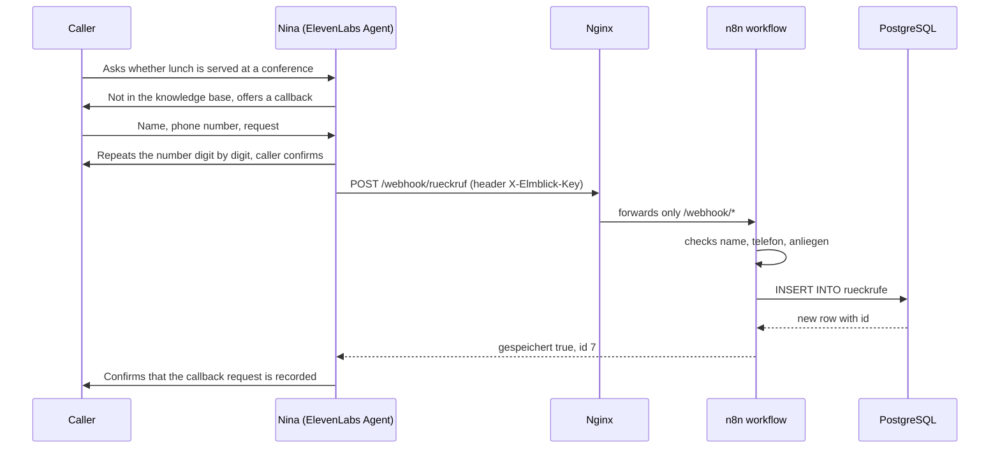

# Voice Agent Hotel

**Nina** is the AI receptionist of *Hotel Elmblick*, a fictional family-run
hotel in Schöningen, Lower Saxony. She picks up the phone in German, answers
questions about rooms, prices, breakfast, arrival and house rules, and takes
callback requests for the team when a question needs a human.

The conversation runs on **ElevenLabs Agents**. When Nina decides a callback
is needed, she uses a webhook tool that sends the request to my own server,
where an **n8n** workflow validates it and stores it in **PostgreSQL**. Everything on
the server runs in **Docker** behind **Nginx** on a Hostinger VPS.

> **Status:** Nina works end to end in the ElevenLabs browser test, including
> the callback tool. A local German phone number (05352, Schöningen) has been
> ordered from Telnyx and is waiting for the regulatory approval required for
> German local numbers. Until then, the agent is not reachable by phone.

<picture>
  <source media="(prefers-color-scheme: dark)" srcset="docs/architecture-dark.svg">
  
</picture>

---

## Contents

- [How it works](#how-it-works)
- [Features](#features)
- [Tech stack](#tech-stack)
- [Project structure](#project-structure)
- [Security](#security)
- [Setup](#setup)
- [Testing the webhook](#testing-the-webhook)
- [Design decisions](#design-decisions)
- [Roadmap](#roadmap)

---

## How it works

The architecture above shows where each part runs. The sequence below follows
a single callback request from the first question to the stored row.



Every stored request carries the ElevenLabs conversation ID (`anruf_id`), so
each row in the database can be traced back to the call transcript.

Field and table names are German because the hotel team works with the data:
`rueckrufe` = callbacks, `telefon` = phone, `anliegen` = request,
`erreichbar` = when to reach the caller, `gespeichert` = saved, `fehlt` = missing,
`offen` / `erledigt` / `nicht_erreicht` = open / done / not reached.

---

## Features

- Natural phone conversation in German
- Answers based on a curated knowledge base of the hotel (`agent/knowledge_base.md`)
- **Tool calling:** Nina decides on her own when a callback request is needed
  and sends it to the webhook with name, phone number, request, availability
  and conversation ID
- Phone numbers are always repeated digit by digit and confirmed before saving
- Server-side validation: incomplete requests are rejected with `400` and a
  list of the missing fields, so Nina can ask for exactly what is missing
- Callback requests stored in PostgreSQL with status `offen`, `erledigt` or
  `nicht_erreicht`
- Honest by design: Nina introduces herself as an AI assistant, never confirms a booking, never
  promises a callback time and never claims to have saved something when the
  tool failed
- Ends the call politely after the caller says goodbye, or after 30 seconds of
  silence
- Cost limits: maximum call duration of five minutes and a monthly spending cap

---

## Tech stack

| Component        | Used for                                                  |
| ---------------- | --------------------------------------------------------- |
| ElevenLabs Agents| Speech recognition, LLM, voice, webhook tool              |
| n8n 2.43         | Webhook, validation and database insert                   |
| PostgreSQL 16    | Callback requests (separate database `hotel`)             |
| Docker Compose   | Runs n8n and PostgreSQL on the server                     |
| Nginx            | Reverse proxy, exposes only the webhook path              |
| Let's Encrypt    | TLS certificate via certbot                               |
| Ubuntu 24.04 VPS | Hostinger, shared with other projects                     |
| Telnyx           | German local phone number via SIP trunk (pending)         |

---

## Project structure

```
Voice-Agent-Hotel/
├── agent/
│   ├── system_prompt.md            # Nina's instructions (German)
│   ├── knowledge_base.md           # What Nina knows about the hotel (German)
│   └── tool_rueckruf_aufnehmen.json  # Webhook tool as exported from ElevenLabs
├── docs/
│   ├── architecture-light.svg      # Architecture diagram (light and dark)
│   ├── architecture-dark.svg
│   └── architecture.archify.json   # Diagram source, built with archify
├── n8n/
│   └── elmblick_rueckrufbitte.json # Workflow export: Webhook → If → Postgres → Respond
├── server/
│   ├── compose.yaml                # n8n + PostgreSQL
│   ├── nginx-n8n.conf              # Only /webhook/ is public
│   └── .env.example                # Required secrets, without values
└── sql/
    ├── 001_hotel_database.sql      # Database, role and table for callback requests
    └── 002_least_privilege.sql     # Separate owner, hotel_app may only INSERT and SELECT
```

---

## Security

- **Only the webhook is public.** Nginx forwards `/webhook/` to n8n and answers
  every other path with `404`, including the editor, the login page and
  `/healthz`. The editor is opened through an SSH tunnel only.
- **Shared secret.** The webhook uses n8n Header Auth (`X-Elmblick-Key`).
  In ElevenLabs the key is stored as a secret, so the language model never
  sees it. Requests without the key get `403`.
- **Ports bound to localhost.** Docker publishes n8n only on
  `127.0.0.1:5678`. This matters because Docker writes its own firewall rules
  in front of `ufw`; a plain `5678:5678` would be reachable from the internet
  even though `ufw` claims otherwise. PostgreSQL has no published port at all.
- **Least privilege.** The workflow writes with its own role `hotel_app`,
  not with the superuser that n8n uses internally. Database and table belong
  to `hotel_owner`, a role without login. `hotel_app` may only `INSERT` and
  `SELECT` on `rueckrufe`, so even with a stolen webhook key nothing can be
  changed or deleted. `CONNECT` on n8n's internal database and on `postgres`
  is revoked from `PUBLIC`.
- **Secrets stay on the server.** `.env` with the database password and the
  n8n encryption key is never committed; see `server/.env.example`.
- **Memory limits.** n8n may use at most 1 GB of RAM and PostgreSQL 512 MB,
  so the agent cannot take memory away from the other services on the same
  VPS.

---

## Setup

### 1. Server

Requires Docker with the Compose plugin, Nginx and certbot with its Nginx
plugin (`python3-certbot-nginx`). The files use my domain
`n8n.benjaminblarr.de`; replace it with yours in `server/compose.yaml`,
`server/nginx-n8n.conf` and `agent/tool_rueckruf_aufnehmen.json` first.

```bash
sudo mkdir -p /opt/voice-agent && sudo chown $USER:$USER /opt/voice-agent
# copy server/compose.yaml and server/nginx-n8n.conf to /opt/voice-agent/
cd /opt/voice-agent
( umask 077; { echo "POSTGRES_PASSWORD=$(openssl rand -hex 24)"; \
  echo "N8N_ENCRYPTION_KEY=$(openssl rand -hex 32)"; } > .env )
sudo docker compose up -d
curl -s http://127.0.0.1:5678/healthz   # {"status":"ok"}
```

Then publish the webhook path through Nginx and get a certificate:

```bash
sudo install -m 644 -o root -g root nginx-n8n.conf /etc/nginx/sites-available/n8n
sudo ln -s /etc/nginx/sites-available/n8n /etc/nginx/sites-enabled/
sudo nginx -t && sudo systemctl reload nginx
sudo certbot --nginx -d n8n.example.com
```

### 2. Database

```bash
sudo docker compose exec postgres psql -U n8n -d n8n
```

Then run the statements from `sql/001_hotel_database.sql` and after that
`sql/002_least_privilege.sql` step by step. The password for `hotel_app` is
set interactively with `\password`.

### 3. n8n

Open the editor through the tunnel
(`ssh -N -L 15678:127.0.0.1:5678 <server>`, then `http://localhost:15678`),
create the owner account and two credentials:

- **Postgres:** host `postgres`, database `hotel`, user `hotel_app`, SSL disabled
- **Header Auth:** name `X-Elmblick-Key`, value from `openssl rand -hex 32`

Import `n8n/elmblick_rueckrufbitte.json`, assign the credentials and publish
the workflow.

### 4. ElevenLabs

Create an agent, paste `agent/system_prompt.md` as the system prompt and add
`agent/knowledge_base.md` to the knowledge base. Create the webhook tool from
`agent/tool_rueckruf_aufnehmen.json` and store the key as a secret header.
Enable the system tool `end_call`.

The first message greets the caller in the name of the hotel, introduces Nina
as the AI assistant of the reception and mentions that the call is recorded.

Limits used in this project: maximum call duration 300 seconds, end the call
after 30 seconds of silence, and a monthly spending cap in the ElevenLabs
billing settings.

---

## Testing the webhook

```bash
read -s KEY   # paste the webhook key, nothing is shown

# complete request: 200
curl -s -X POST https://n8n.example.com/webhook/rueckruf \
  -H "Content-Type: application/json" -H "X-Elmblick-Key: $KEY" \
  -d '{"name":"Test","telefon":"05352 123456","anliegen":"Frage zur Anreise"}'
# {"gespeichert":true,"id":6}

# blank name, no phone number: 400
curl -s -X POST https://n8n.example.com/webhook/rueckruf \
  -H "Content-Type: application/json" -H "X-Elmblick-Key: $KEY" \
  -d '{"name":"   ","anliegen":"Test"}'
# {"gespeichert":false,"fehlt":["name","telefon"]}

# without key: 403
```

---

## Design decisions

- **Nina takes every call, the team calls back.** She is the first point of
  contact, not an overflow line. She never transfers callers or gives them
  another number to call, and bookings go through the hotel website.
- **Requests, not bookings.** Nina never confirms a room, a late check-out or
  an arrival after 22:00. She only says what actually happened.
- **No payment data on the phone.** If a caller starts reading out card
  details, Nina interrupts politely.
- **The caller hangs up first.** As at any good reception, Nina says goodbye
  once and ends the call only after the caller has said goodbye too.
- **Fictional hotel, real place.** The hotel and all prices are invented; the
  directions and surroundings of Schöningen are real.

---

## Roadmap

1. **Information and callbacks** (done, phone number pending):
   questions, callback requests, database
2. **Availability and booking requests:** check free rooms for a period from a
   price table and record the request
3. **Service during the stay:** wake-up calls, late check-out or a table in
   the restaurant as tasks for the team, based on the room number
4. **Evaluation:** store every call via post-call webhook and analyse it with
   SQL, for example the share of calls solved without a callback
